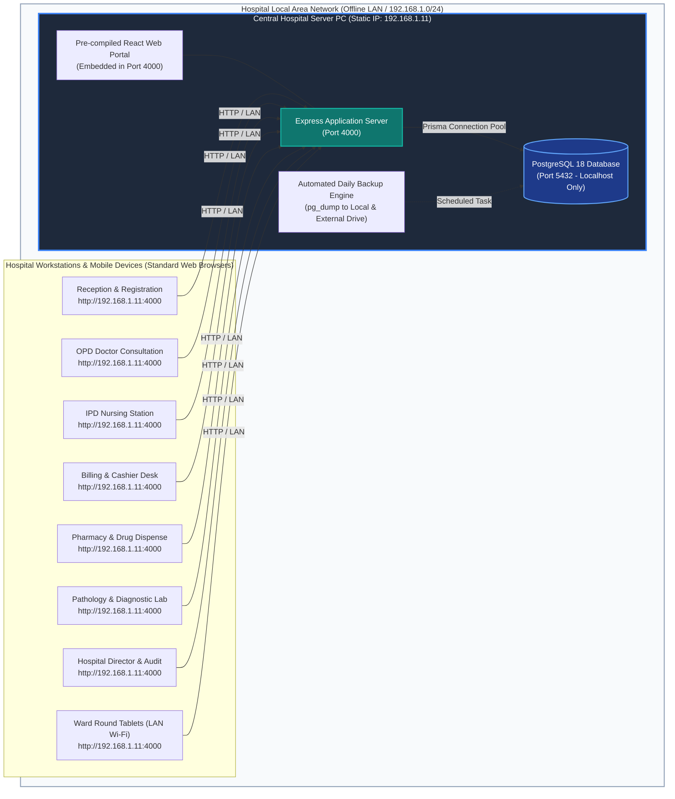
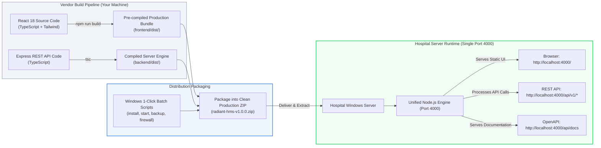
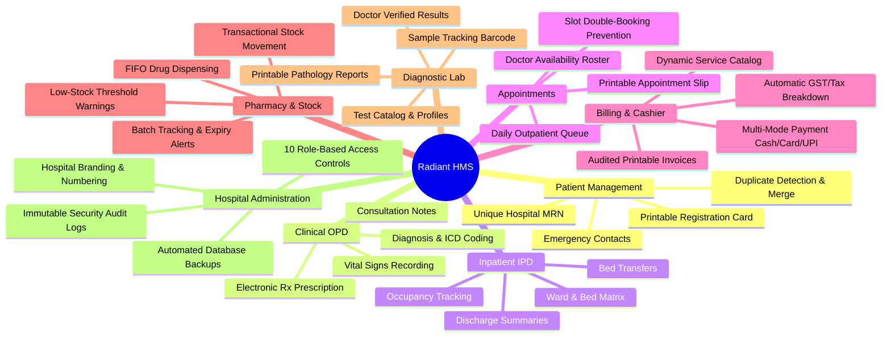
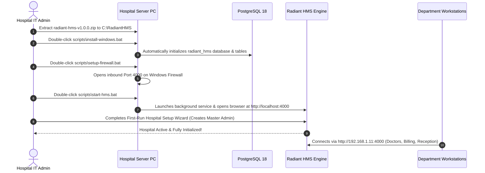
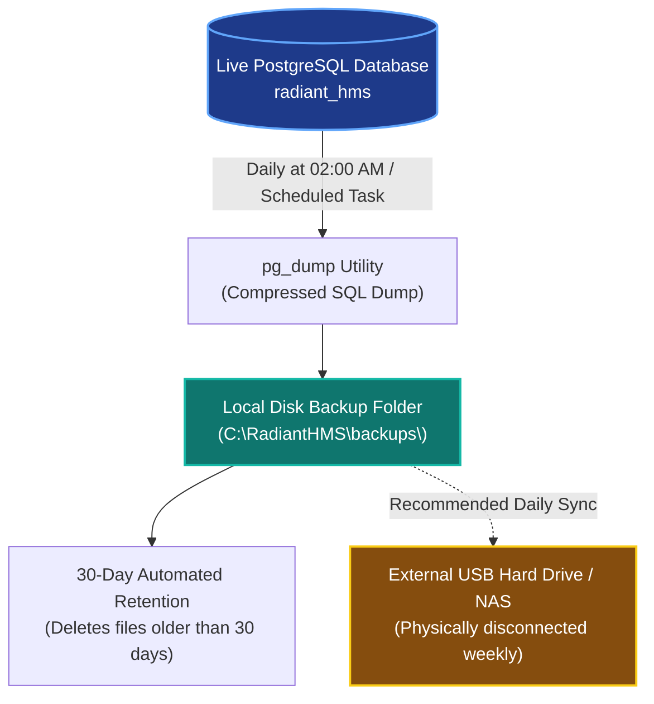

# Hospital Management System (HMS)
## Production Technical Specification, Architecture Schematics & Deployment Guide

> **Confidential Document**  
> **Prepared For:** Hospital Board of Directors, Medical Superintendents & IT Administration  
> **Prepared By:** Healthcare Software Engineering & Architecture Team  
> **Version:** 1.0.0 (Production Release)  
> **Deployment Model:** 100% On-Premise, Offline-First Local Area Network (LAN)

---

## 1. Executive Summary

The **Radiant Hospital Management System (HMS)** is a modular, high-performance healthcare operations platform engineered specifically for **independent, on-premise hospital deployment**. 

Unlike modern SaaS platforms that depend on continuous internet connectivity and external cloud vendors, Radiant HMS runs entirely on the hospital's dedicated local hardware. Patient health records, diagnostic files, financial ledgers, and operational data **never leave the physical perimeter of the hospital facility**.

### Key Value Pillars
* **100% Offline-First Operations:** The hospital operates at full capacity even during external internet outages, telco disruptions, or cloud service blackouts.
* **Complete Data Ownership & Zero Cloud Fees:** No recurring cloud storage fees, API gateway surcharges, or external database hosting bills.
* **Zero Client Workstation Installs:** Staff access the system through existing web browsers (Chrome, Edge, Firefox, Safari) on desktop PCs, nursing station laptops, and tablets.
* **Strict Legal & Data Privacy Compliance:** Meets all clinical data localization mandates by housing data in an enterprise-grade, encrypted local PostgreSQL engine.
* **High Availability & Automated Disaster Recovery:** Includes built-in, automated daily backups with retention rotation and 1-click disaster recovery.

---

## 2. Technology Stack & Technical Rationale

The software is engineered using an enterprise, industry-proven open-source stack that guarantees long-term maintainability, zero proprietary licensing fees, and instant sub-second response times.

| Layer | Technology | Version | Engineering Rationale |
| :--- | :--- | :--- | :--- |
| **Frontend UI** | **React & TypeScript** | 18.3 / 5.8 | Reactive, component-driven clinical interface with strict type safety to prevent runtime errors. |
| **Build Engine** | **Vite** | 6.4 | Ultra-optimized module bundler producing minimal static asset bundles served directly from the local server. |
| **Styling** | **Tailwind CSS** | 3.4 | Clean, accessible, medical-grade design system with native `@media print` stylesheets for invoices and prescriptions. |
| **State Management** | **TanStack Query** | 5.67 | Intelligent client-side caching and background synchronization, minimizing network overhead on the local LAN. |
| **Forms & Validation** | **React Hook Form + Zod** | 7.54 / 3.24 | Strict schema-based data validation on patient intake, drug dosages, and billing amounts before submission. |
| **Backend Runtime** | **Node.js LTS** | 20+ / 22+ | Non-blocking, event-driven I/O capable of handling hundreds of concurrent hospital staff requests concurrently. |
| **API Framework** | **Express.js & TypeScript** | 4.21 / 5.8 | Industry-standard, modular REST API with structured middleware for authentication, logging, and rate limiting. |
| **Database Engine** | **PostgreSQL** | 18.6 | World’s most advanced open-source relational database. ACID-compliant with foreign key integrity and transactional isolation. |
| **ORM & Migrations** | **Prisma ORM** | 6.19 | Strictly typed relational schema management with automated versioned migrations. |
| **Security & Hashing**| **bcryptjs & JWT** | 3.0 / 9.0 | 12-round salted password hashing and stateless, time-limited JSON Web Tokens with automated rotation. |
| **API Documentation**| **Swagger / OpenAPI** | 3.0 | Living interactive documentation served at `/api/docs` enabling seamless integration with hospital equipment. |

---

## 3. Architecture Schematics & Network Topology

### 3.1. Physical Hospital LAN Network Topology

The diagram below illustrates how client workstations across hospital departments interact with the central Server PC over the existing local switch/Wi-Fi router without accessing the public internet:



### 3.2. Single-Port Embedded Distribution Architecture

To eliminate complex web server configurations (like Apache or external IIS setups) and minimize firewall attack surfaces, **the frontend and backend are distributed as a single unified service**:



---

## 4. Functional Healthcare Modules

The application delivers **11 fully integrated modules** designed around clinical workflows:



---

## 5. Security & Access Control Model

### 5.1. Multi-Role Permission Matrix (RBAC)

The system enforces strict server-side permission checks. Even if an unauthorized user attempts to manipulate the web interface, the backend API rejects unauthorized requests with `403 Forbidden`.

| Role | Dashboard | Patients | Appointments | OPD Clinical | IPD Wards | Billing | Pharmacy | Pathology | Settings |
| :--- | :---: | :---: | :---: | :---: | :---: | :---: | :---: | :---: | :---: |
| **System Administrator** | Full | Full | Full | View | View | Full | Full | Full | Full |
| **Hospital Administrator** | Full | Full | Full | View | View | Full | View | View | Manage |
| **Doctor** | Clinical | View / Edit | View / Roster | Full | Full | View | View | Review | None |
| **Nurse** | Clinical | View | View | Vitals | Full | None | View | Collect | None |
| **Receptionist** | FrontDesk | Register | Book / Cancel | None | View | None | None | None | None |
| **Billing Cashier** | Financial | View | None | None | View | Full | View | None | None |
| **Pharmacist** | Inventory | View | None | None | None | None | Full | None | None |
| **Laboratory Tech** | Diagnostics | View | None | None | None | None | None | Full | None |
| **Auditor** | Read-Only | Read-Only | Read-Only | Read-Only | Read-Only | Read-Only | Read-Only | Read-Only | Read-Only |

### 5.2. Data Security & Defense-in-Depth
1. **Network Isolation:** PostgreSQL port `5432` listens **only** on `127.0.0.1` (localhost). No computer on the hospital network can connect directly to the database; all queries must pass through authenticated backend API endpoints.
2. **Credential Protection:** Passwords are encrypted using **bcrypt** with 12 salt rounds. Passwords are never stored in plaintext.
3. **Session Safety:** Dual-token JWT architecture with automatic 8-hour access expiration and 7-day refresh token rotation.
4. **Brute-Force Shield:** IP rate limiters restrict authentication attempts to 5 failures per 15 minutes before temporary lockout.
5. **Immutable Audit Trail:** Sensitive clinical events (patient merging, invoice adjustments, stock corrections) are written to an append-only `AuditLog` table capturing the exact user, IP address, timestamp, and action.

---

## 6. How the Software is Packaged & Distributed

As the engineering provider, you do **not** ship development code or require hospital staff to install development tools (such as Git or Vite). You deliver a self-contained, pre-compiled distribution archive.

### 6.1. The Distribution ZIP Package Contents

The distributed `radiant-hms-v1.0.0.zip` file contains:

```
radiant-hms-v1.0.0/
├── backend/
│   ├── dist/                 <-- Pre-compiled backend JavaScript engine
│   ├── node_modules/         <-- Production dependencies only
│   ├── prisma/
│   │   └── schema.prisma     <-- Database schema definitions
│   ├── .env                  <-- Configured database & security credentials
│   └── package.json
├── frontend/
│   └── dist/                 <-- Pre-compiled React SPA (HTML, CSS, JS, SVGs)
├── scripts/
│   ├── install-windows.bat   <-- 1-Click setup script
│   ├── start-hms.bat         <-- 1-Click server launcher
│   ├── stop-hms.bat          <-- Clean shutdown utility
│   ├── setup-firewall.bat    <-- Automatic Windows Firewall LAN port 4000 opener
│   ├── backup-db.bat         <-- Automated database backup utility
│   └── restore-db.bat        <-- Disaster recovery restoration tool
├── docs/                     <-- Administrator manuals & disaster recovery guides
└── README.html               <-- Visual quick-start guide for hospital IT staff
```

---

## 7. Client Server Hardware & Software Prerequisites

### 7.1. Recommended Hospital Server PC Specifications

The application is lightweight and efficient. A dedicated modern desktop PC or small server is sufficient for hospitals with up to 150 concurrent workstations.

| Component | Minimum Specification | Recommended Specification (100+ Beds) |
| :--- | :--- | :--- |
| **Operating System** | Windows 10 Pro / Windows 11 Pro (64-bit) | Windows Server 2019 / 2022 (64-bit) |
| **Processor (CPU)** | Intel Core i3 (10th Gen+) / AMD Ryzen 3 | Intel Core i5/i7 (11th Gen+) / AMD Ryzen 5 |
| **Memory (RAM)** | 8 GB DDR4 | 16 GB DDR4/DDR5 |
| **Storage (Disk)** | 256 GB SSD (Solid State Drive) | 512 GB NVMe SSD (Configured with RAID 1) |
| **Network Interface** | 100 Mbps Ethernet | 1 Gbps Gigabit Ethernet connected to core switch |
| **Power Backup** | Dedicated 600VA UPS | 1kVA - 2kVA UPS with automated shutdown signal |

> [!IMPORTANT]
> **Server Availability Rule:** The Server PC must remain continuously powered on with sleep/hibernate disabled in Windows Power Settings so that workstations can access the hospital portal 24/7.

### 7.2. Software Prerequisites to Install on the Server PC
Only two standard open-source runtimes are required on the Server PC:
1. **Node.js LTS (v20 or v22):** Downloaded from [nodejs.org](https://nodejs.org/) (Standard installer).
2. **PostgreSQL (v16 or v18):** Downloaded from [postgresql.org](https://www.postgresql.org/download/windows/) (Default port 5432).

*Note: Workstation PCs (reception, doctors, pharmacy) require **no software installation** whatsoever—only a web browser.*

---

## 8. Step-by-Step Installation & Deployment Procedure

Deployment takes **under 15 minutes** on a fresh Windows server.



### Detailed Setup Steps:

#### Step 1: Assign a Static LAN IP to the Server PC
1. On the Server PC, open **Windows Settings** &rarr; **Network & Internet** &rarr; **Ethernet**.
2. Set IP assignment to **Manual (Static)** (e.g., `192.168.1.11`, Subnet: `255.255.255.0`, Gateway: `192.168.1.1`).
3. This ensures client workstations always find the server at the exact same address.

#### Step 2: Extract the Package
Extract `radiant-hms-v1.0.0.zip` into a permanent directory (e.g., `C:\RadiantHMS`).

#### Step 3: Run the 1-Click Installer
1. Right-click `scripts\install-windows.bat` and select **Run as Administrator**.
2. The script automatically:
   - Verifies Node.js and PostgreSQL connectivity.
   - Synchronizes all 32 database tables and relational indexes.
   - Generates the optimized local Prisma data client.

#### Step 4: Configure the Windows Firewall
1. Right-click `scripts\setup-firewall.bat` and select **Run as Administrator**.
2. This creates an inbound firewall rule named `"Radiant Hospitals HMS (Port 4000)"`, allowing client computers on the hospital LAN to communicate with the portal.

#### Step 5: Start the Hospital System
1. Double-click `scripts\start-hms.bat`.
2. The server initializes and immediately opens the hospital administration portal in your default web browser at `http://localhost:4000`.

#### Step 6: Complete the First-Run Setup Wizard
1. On first launch, the browser displays the **Hospital Setup Wizard**.
2. Fill in:
   - **Hospital Details:** Hospital Name, Legal Registration Code, Address, Phone, Currency symbol (e.g. `$`, `₹`, `€`).
   - **Master Administrator:** Administrator Full Name, Official Email, and a Secure Master Password.
3. Click **Initialize Hospital System**.
4. The system seeds default departments (General Medicine, Emergency, Surgery, Pediatrics, etc.) and redirects you to the live dashboard.

---

## 9. Automated Backup & Disaster Recovery Plan

Protecting patient records is the highest operational priority. Radiant HMS includes an industrial-grade, automated backup system.

### 9.1. Backup Architecture & Retention Policy



### 9.2. Automated Backup Setup (Windows Task Scheduler)
To run automated daily backups every night at 2:00 AM:
1. Open Windows **Task Scheduler**.
2. Select **Create Basic Task** &rarr; Name: `RadiantHMS_Daily_Backup`.
3. Trigger: **Daily at 02:00 AM**.
4. Action: **Start a Program** &rarr; Select `C:\RadiantHMS\scripts\backup-db.bat`.
5. Finish. Every night, a timestamped snapshot (e.g., `radiant_hms_backup_20261017_020000.sql`) is generated automatically.

### 9.3. 1-Click Disaster Recovery Procedure
If the server suffers a hardware failure, you can restore full operations on a new PC in **under 10 minutes**:
1. Install Node.js and PostgreSQL on the replacement PC.
2. Extract the `radiant-hms-v1.0.0.zip` package.
3. Run `scripts\restore-db.bat`.
4. Provide the path to the latest `.sql` backup file.
5. Type `RESTORE` to confirm. The script recreates all patient records, medical charts, invoices, and audit logs with zero data corruption.

---

## 10. Workstation Access Instructions for Hospital Staff

No software, plugins, or extensions are needed on client PCs.

1. Connect the computer or tablet to the hospital’s wired LAN switch or secure medical Wi-Fi.
2. Open any web browser (Google Chrome, Microsoft Edge, Mozilla Firefox, or Safari).
3. Type the Server PC’s LAN address in the address bar:
   ```
   http://192.168.1.11:4000
   ```
4. Bookmark the link or create a desktop shortcut named **"Hospital Portal"**.
5. Log in with the individual staff credentials assigned by the Hospital Administrator.

---

## 11. Future Scalability & Mobile App Readiness

The Radiant HMS backend is built using pure **RESTful JSON APIs** and stateless JWT authentication. In Phase 2:
- A **React Native Mobile App** (for Doctors on round or Patient self-service portals) can plug directly into the existing `/api/v1/*` endpoints without altering a single line of backend code.
- Digital medical diagnostic equipment (e.g., automated lab analyzers, blood pressure monitors) can stream results directly into the `/api/v1/lab` endpoints via local LAN webhooks.

---

## 12. Summary of Deliverables & Vendor Support

| Deliverable | Description |
| :--- | :--- |
| **Complete Application Archive** | `radiant-hms-v1.0.0.zip` containing all pre-compiled frontend & backend services. |
| **Production Database Schema** | 32 relational tables covering Patient EMR, OPD, IPD, Billing, Pharmacy, and Lab. |
| **1-Click Automation Scripts** | Windows `.bat` utilities for installation, execution, firewall, and backups. |
| **Interactive API Documentation** | Built-in Swagger OpenAPI specification at `/api/docs`. |
| **Disaster Recovery Playbook** | Step-by-step restoration and validation procedures. |
| **Warranty & Updates** | Controlled, versioned updates with automated schema migrations. |

---

*Radiant Hospitals HMS &bull; Engineered for Clinical Reliability, Data Security, and Operational Independence.*
