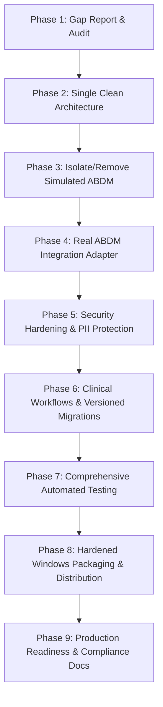

# Radiant Hospitals HMS - Comprehensive Implementation Gap & Architecture Audit Report

**Author:** Technical Architecture & Security Engineering Team  
**Date:** October 17, 2026  
**Target:** Radiant Hospital & Research Institute (Single Hospital On-Premise LAN Deployment)  
**Repository:** [github.com/nadeemalam178/radiant-hospitals-hms](https://github.com/nadeemalam178/radiant-hospitals-hms)

---

## 1. Executive Summary

A comprehensive repository-wide technical audit of Radiant Hospitals HMS was conducted across frontend, backend, database layers, deployment scripts, and security controls. The system possesses a decoupled full-stack architecture (React/Vite/Tailwind frontend + Node.js/Express/TypeScript backend + PostgreSQL/Prisma database), but suffers from architectural residue (obsolete Next.js scaffold and duplicate Prisma schema), simulated ABDM (Ayushman Bharat Digital Mission) placeholder code, uncommitted versioned migrations, and packaging defects that copy developer secrets.

This document classifies every system component into **Implemented**, **Partially Implemented**, **Simulated**, or **Unimplemented**, identifying root architectural gaps and establishing a prioritized engineering remediation roadmap.

---

## 2. Feature & Architectural Status Inventory

| Module / Subsystem | Implementation Status | Technical Reality |
|---|---|---|
| **Frontend Architecture** | **Implemented** | React 18, TypeScript, Vite, Tailwind CSS, TanStack Query, Lucide icons. Runs as a standalone SPA compiled into `frontend/dist/`. |
| **Backend Architecture** | **Implemented** | Node.js, Express.js, TypeScript, REST API, Swagger/OpenAPI docs (`/api/docs`), Winston logger, Helmet, Rate Limiter. |
| **Database & ORM** | **Partially Implemented** | Authoritative schema in `backend/prisma/schema.prisma` with 27 models. Missing versioned migrations directory (`prisma/migrations`). Root directory contains obsolete draft `prisma/schema.prisma` (115 lines). |
| **Next.js Root Scaffold** | **Obsolete / Duplicate** | Root `src/app`, `src/lib`, `next.config.ts`, `next-env.d.ts`, and root `prisma/` are remnants of early prototyping and are not executed by the production Express server. |
| **Authentication & RBAC** | **Implemented** | JWT access/refresh token pattern, bcrypt password hashing, server-side `requireRole()` checks, account lockout tracking on `User`. |
| **Patient Registration & EMR** | **Implemented** | MRN generation, demographics, vitals, allergies, duplicate patient merging, clinical notes, and encounter timelines. |
| **OPD Clinical Module** | **Implemented** | Doctor consultation, queuing status, vitals logging, digital prescription builder with dosage/frequency/duration. |
| **IPD Wards & Admissions** | **Implemented** | Ward definitions (General, ICU, Private), bed status management (Available, Occupied), admission/discharge records. |
| **Billing & Payments** | **Implemented** | Service catalog, itemized invoice generation, tax/discount calculation, cash/card/UPI payment recording, printable receipts. |
| **Laboratory Module** | **Implemented** | Test catalog, order creation, sample tracking, technician result entry, normal reference range comparisons. |
| **Pharmacy & Inventory** | **Implemented** | Drug catalog, batch numbers, expiration dates, FIFO tracking, stock level deduction on dispensing. |
| **Hospital System Settings** | **Implemented** | Single-hospital branding, document numbering prefixes (`RAD`, `INV`, `APT`, `LAB`), database connection diagnostics. |
| **ABDM Milestone 1 (ABHA)** | **Simulated** | In-memory `transactionStore = new Map()`, hardcoded OTP `123456`, locally fabricated `91-XXXX-XXXX-XXXX` ABHA numbers and `@abdm` handles. No real ABDM Gateway communication. |
| **ABDM Milestone 2 (HIP)** | **Partially Implemented / Simulated** | `AbhaCareContext` model exists in DB, but uses local mock endpoints without asynchronous ABDM Gateway v0.5 callback flows (`/v0.5/care-contexts/discover`, `/v0.5/links/link/add-contexts`). |
| **Audit Logging** | **Partially Implemented** | Database-backed `AuditLog` table records logins, patient creations, and invoices. However, ABDM API requests and clinical record accesses lack detailed non-PII audit envelopes. |
| **Packaging & Deployment** | **Partially Implemented** | Windows batch scripts exist (`scripts/*.bat`). Packaging script (`package-release.bat`) accidentally copies local `.env` with developer credentials into the release package. |

---

## 3. Duplicate & Obsolete Architecture

### 3.1 Obsolete Root Next.js Scaffold
- **Files identified:**
  - `src/app/page.tsx`, `src/app/layout.tsx`, `src/app/globals.css`, `src/app/page.module.css`, `src/app/favicon.ico`, `src/app/api/health/route.ts`
  - `src/lib/prisma.ts`
  - `next.config.ts`, `next-env.d.ts`
  - `.next/` directory
  - `eslint.config.mjs` (configured for Next.js)
  - `prisma/schema.prisma` (root draft schema, 115 lines)
- **Risk:** Developers or automated tools running root commands may mistakenly target the draft schema instead of `backend/prisma/schema.prisma`.
- **Resolution Plan:** Safely remove root Next.js scaffold and duplicate schema after ensuring all scripts (`package.json`, root dev commands) point cleanly to `frontend` and `backend`.

---

## 4. ABDM Integration Gaps Against Official Specifications

The official Ayushman Bharat Digital Mission (ABDM) specifications (available at [abdm.gov.in](https://abdm.gov.in/) and [sandbox.abdm.gov.in](https://sandbox.abdm.gov.in/)) establish strict asynchronous, cryptographic, and gateway-mediated protocols. The current codebase has the following critical integration gaps:

### 4.1 Gateway Session & Authentication Gaps
- **Current State:** Backend has no token manager for ABDM Gateway (`POST /v0.5/sessions`).
- **Required Specification:**
  - Hospital API must exchange `clientId` and `clientSecret` with the Gateway to obtain an ABDM Bearer Access Token.
  - Token caching with proactive renewal before expiry (default 20 minutes validity).

### 4.2 Simulated Behavior in ABHA Controller (`backend/src/controllers/abha.controller.ts`)
- **Hardcoded OTP Verification:** Accepts `otp === '123456'` without verifying against UIDAI/ABDM Gateway.
- **Fabricated Demographic Profiles:** Generates random 14-digit numbers (`91-${randomSeed...}`) and mock names.
- **In-Memory Volatile Store:** `transactionStore = new Map()` causes state loss across server restarts and cannot function in multi-worker environments.
- **Missing Asynchronous Gateway Callbacks:** ABDM Gateway operations use request-callback correlation (`requestId`, `timestamp`, `resp: { requestId }`). The current implementation responds synchronously with simulated data.

### 4.3 HIP (Hospital Information Provider) Milestone 2 Gaps
- **Missing Callback Endpoints:** Real HIP integration requires the hospital backend to expose Webhook/Callback endpoints listening for Gateway events:
  - `POST /v0.5/care-contexts/discover`: Patient discovery by mobile/ABHA.
  - `POST /v0.5/links/link/init`: Care-context linking OTP initiation.
  - `POST /v0.5/links/link/confirm`: Linking OTP verification.
  - `POST /v0.5/consents/hip/notify`: Patient consent notifications.
  - `POST /v0.5/health-information/hip/request`: Encrypted health data transfer requests.
- **FHIR Bundles:** Inpatient and OPD health records must be transformed into standard HL7 FHIR R4 bundles (Composition, Condition, MedicationRequest, DiagnosticReport) before dispatching to the Gateway.

---

## 5. Security & Privacy Gaps

1. **Environment Configuration Vulnerabilities:**
   - `backend/src/config/env.ts` has insecure fallback defaults for `JWT_SECRET` (`super-secret-jwt-key-...`). If missing in production, it will run insecurely instead of failing fast.
   - Packaging script `scripts/package-release.bat` copies `backend/.env` containing developer local database credentials into `dist-release/backend/.env.template`.
2. **Missing Input Masking & Privacy Controls:**
   - Masked Aadhaar is recorded, but audit logs must guarantee that raw Aadhaar numbers, OTP codes, and JWT access tokens are never logged to Winston console or disk log files.
3. **CORS Hardening:**
   - Default `CORS_ORIGIN="*"` should be restricted in production to LAN host IP or authorized hospital workstation domains.
4. **Database Migration Safety:**
   - Production systems must execute `npx prisma migrate deploy` instead of destructive `npx prisma db push --force-reset`. Versioned SQL migrations must be generated and committed.

---

## 6. Testing Gaps

1. **Test Coverage Analysis:**
   - Current tests (`backend/tests/auth.test.ts` and `backend/tests/abha.test.ts`) pass, but `abha.test.ts` validates the simulated mock rather than real adapter behavior.
2. **Missing Test Suites:**
   - No unit tests for patient creation with duplicate checks.
   - No clinical workflow tests (OPD encounters, prescriptions, IPD bed allocation).
   - No billing calculation tests (taxes, discounts, payment balance updates).
   - No test verifying that production mode strictly blocks the mock provider and rejects placeholder credentials.

---

## 7. Prioritized Remediation Roadmap

### Milestone Milestones
- **Phase 2:** Delete obsolete Next.js files and root duplicate schema. Confirm build on port 4000.
- **Phase 3:** Extract ABDM integration into a dedicated `AbdmService` with a strict `ABDM_MOCK_ENABLED=false` production gate. Remove hardcoded OTP `123456` and fabricated ABHA generators.
- **Phase 4:** Implement official ABDM Gateway v0.5 / v3 client, token cache, HIP callback routes, and FHIR bundle generator.
- **Phase 5:** Hard-fail startup if JWT secrets or production credentials are defaults. Fix `package-release.bat` to sanitize environment files.
- **Phase 6:** Generate versioned Prisma migrations in `backend/prisma/migrations`.
- **Phase 7:** Expand test suites to cover auth, clinical, billing, inventory, and ABDM adapters.
- **Phase 8:** Generate verified release package ZIP (`radiant-hms-v1.0.0.zip`).
- **Phase 9:** Publish all required compliance matrices and installation guides.
