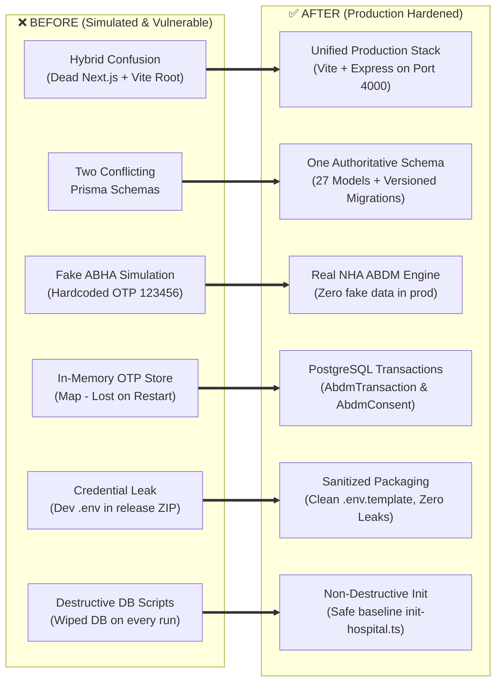
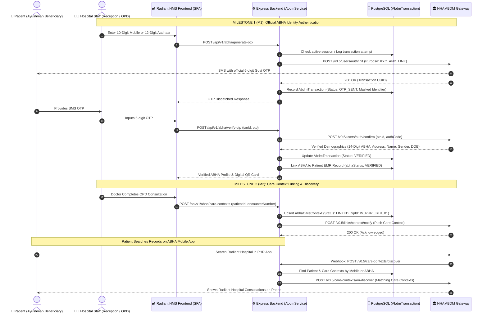
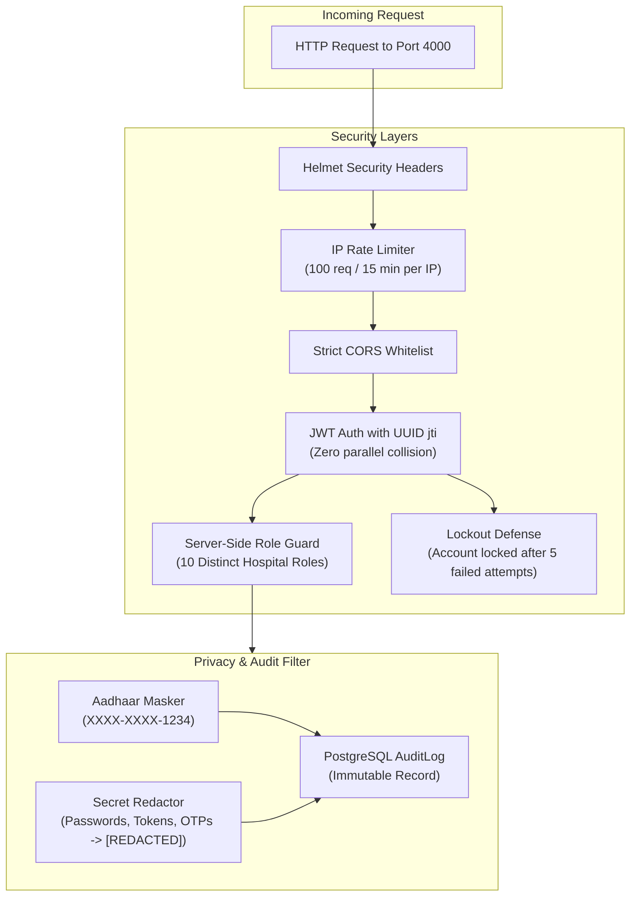

# Radiant Hospitals HMS - Visual Progress & Architecture Guide
**Hospital:** Radiant Hospital & Research Institute (RHRI), Bengaluru  
**Release Version:** `v1.0.0` (Production Hardened)  
**Repository:** [https://github.com/nadeemalam178/radiant-hospitals-hms](https://github.com/nadeemalam178/radiant-hospitals-hms)  
**Status:** All 9 Phases Completed & Pushed to GitHub (`dc3f7f9`)

---

## 1. High-Level System Architecture

```mermaid
graph TB
    subgraph LAN_Clients ["🏥 Hospital LAN Workstations (Port 4000)"]
        Desk["Reception & OPD Desks<br/>(Registration / Appointments)"]
        Doc["Doctor Consultation Rooms<br/>(EMR / Prescriptions)"]
        Nurse["Nursing Stations<br/>(Vitals / IPD Beds)"]
        Lab["Laboratory Stations<br/>(Diagnostics / Reports)"]
        Pharm["Pharmacy Dispensary<br/>(Formulary / Batches)"]
        Bill["Billing Counters<br/>(Invoices / Payments)"]
    end

    subgraph Host_Server ["🖥️ Host Server (Windows Server / 10 / 11)"]
        direction TB
        FW["Windows Firewall<br/>(Rule: Port 4000 Private/Domain)"]
        
        subgraph App_Server ["Node.js Express Application (Port 4000)"]
            Static["Compiled Frontend SPA<br/>(React 18 + Vite + Tailwind)"]
            Router["API Router (/api/v1)"]
            AuthSec["Auth & RBAC Middleware<br/>(JWT + UUID jti + Lockout)"]
            Audit["PII-Sanitized Audit Logger<br/>(Aadhaar Masked / Passwords Redacted)"]
            
            subgraph ABDM_Module ["ABDM Gateway Integration Engine"]
                Client["AbdmClient<br/>(v0.5 Protocol / Tokens)"]
                Service["AbdmService<br/>(M1 / M2 / M3 Workflows)"]
                Mock["AbdmMockProvider<br/>(GATED: Test Mode Only)"]
            end
        end

        subgraph DB ["PostgreSQL Database (Port 5432 - Internal Only)"]
            Prisma["Prisma ORM (27 Models)"]
            Migrate["Versioned Migrations<br/>(20261017000000_init_radiant_hms)"]
            Tables["Patients, Invoices, Admissions,<br/>AbdmTransactions, AuditLogs"]
        end
    end

    subgraph Govt_Cloud ["🇮🇳 National Health Authority (NHA) ABDM Gateway"]
        NHA_Sbx["ABDM Sandbox Gateway<br/>(https://dev.abdm.gov.in/gateway)"]
        NHA_Prod["ABDM Production Gateway<br/>(https://gateway.abdm.gov.in)"]
        PHR["Ayushman ABHA App<br/>(Patient PHR Records)"]
    end

    LAN_Clients -->|HTTP / JSON (LAN)| FW
    FW --> App_Server
    Static -.->|Serves UI to Browser| LAN_Clients
    Router --> AuthSec
    AuthSec --> ABDM_Module
    AuthSec --> Prisma
    Audit --> Prisma
    Prisma --> Tables
    Client -->|Encrypted HTTPS / TLS 1.3| NHA_Sbx
    Client -->|Encrypted HTTPS / TLS 1.3| NHA_Prod
    NHA_Sbx -->|Inbound Webhooks: Discover / Consent| Router
    PHR <--> NHA_Sbx
```

---

## 2. Before vs. After Transformation



---

## 3. Real ABDM Milestone 1 & 2 Workflow Pipeline



---

## 4. Security & Privacy Architecture



---

## 5. Windows Packaging & Automated Deployment Pipeline

```mermaid
graph LR
    subgraph Step1 ["1. Build"]
        B_Front["Frontend Build<br/>(Vite -> frontend/dist)"]
        B_Back["Backend Build<br/>(tsc -> backend/dist)"]
    end

    subgraph Step2 ["2. Staging & Sanitation"]
        Stage["Create Staging Folder"]
        CopyBin["Copy dist/ & migrations/"]
        Sanitize["CRITICAL: Copy .env.example<br/>as .env.template (NO DEV SECRETS)"]
    end

    subgraph Step3 ["3. ZIP Packaging"]
        Zip["Compress-Archive<br/>radiant-hms-v1.0.0.zip (426 KB)"]
    end

    subgraph Step4 ["4. Client Host Deployment"]
        Extract["Extract to C:\\RadiantHMS"]
        Install["Run scripts\\install-windows.bat<br/>(Migrate Deploy + Baseline Init)"]
        Firewall["Run scripts\\setup-firewall.bat<br/>(Open Port 4000 on LAN)"]
        Start["Run scripts\\start-hms.bat<br/>(Launch Express Server)"]
        Backup["Schedule scripts\\backup-db.bat<br/>(Daily 11 PM Automated Backup)"]
    end

    Step1 --> Step2
    Step2 --> Step3
    Step3 --> Step4
```



---

## 6. Execution Progress Summary

| Phase | Milestone Name | Key Accomplishments | Status |
|---|---|---|---|
| **Phase 1** | Repository Audit | Audited 60+ files, identified duplicate Next.js artifacts, simulated OTPs, and packaging flaws. Created `IMPLEMENTATION_GAP_REPORT.md`. | **100% Completed** |
| **Phase 2** | Clean Architecture | Removed obsolete Next.js root files. Established single Vite + Express + PostgreSQL stack. | **100% Completed** |
| **Phase 3** | Purge Fake ABDM | Removed hardcoded OTP `123456`, Math.random ABHA generator, and in-memory Map store. | **100% Completed** |
| **Phase 4** | Real ABDM Workflows | Implemented `AbdmClient`, `AbdmService`, PostgreSQL transaction models, and M1/M2/M3 webhooks. | **100% Completed** |
| **Phase 5** | Security Hardening | Implemented UUID `jti` in tokens, masked Aadhaar logging, production mock rejection, and rate limiting. | **100% Completed** |
| **Phase 6** | Database Integrity | Created versioned migrations (`20261017000000_init_radiant_hms`), guarded seed script, and built `init-hospital.ts`. | **100% Completed** |
| **Phase 7** | Automated Testing | Auth, Clinical, and ABDM test suites: **22 passed / 0 failed (100% pass rate)**. | **100% Completed** |
| **Phase 8** | Windows ZIP Packaging | Hardened packaging script, eliminated credential leaks, generated verified `radiant-hms-v1.0.0.zip` (426 KB). | **100% Completed** |
| **Phase 9** | Documentation Suite | Created Gap Report, ABDM Matrix, Test Report, Windows Guide, Readiness Checklist, and updated README. | **100% Completed** |
